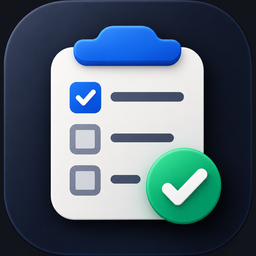

<p align="center">
  
</p>

<h1 align="center">TaskHub</h1>

<p align="center">
  A free, offline, timeline-first task planner for Android. No accounts, no ads, no paywalls.
</p>

<p align="center">
  
  
  
  
  
  
</p>

<p align="center">
  <a href="https://github.com/karthikhegde25/TaskHub/releases">
    
  </a>
</p>

---

## About

TaskHub plans your days on a continuous timeline. Scroll up and down through days without end, tick tasks off
with a sound of your choice, and keep everything on your device. Package: `com.kARThik.tasks`.

## Features

- **Timeline**: endless scrolling through days, with a "Today" shortcut, Day Mode, and a week/month calendar that
  tucks away while you scroll. Tap Overdue or Unplanned to see those tasks in their own list.
- **Agenda view**: clock-time canvas; long-press to drag, bottom handle to resize (15-minute snap).
- **Priorities**: None, Low, Medium, High and Urgent, shown with colored flags.
- **Labels**: colored labels with dots on tasks.
- **Boards** (projects), Unplanned, Notes, Reminders, Tags, Templates, Search, Repeating Tasks and Statistics.
- **Quick add**: type naturally, for example `tomorrow 5pm p1 @home #Work !30m` or `every mon, wed`.
- **Recurrence**: daily, weekly, monthly and yearly, with intervals and weekday sets. Completing a task creates the
  next one; deleting a repeating task removes its open series.
- **Reminders**: exact alarms, several per task, snooze and Done actions, re-armed after reboot.
- **Task complete sounds**: 12 built-in sounds (Hero 1 by default), chosen in More.
- **Calendar import** from the device calendar, **home screen widget** (Timeline / Project / Notes / Unplanned).
- **Themes**: light, dark or system, 7 palettes, customizable bottom navigation.
- Confirmation before deleting a task or note.

## Privacy

Everything is stored locally on your device. There is no account, no cloud sync, no analytics and no ads.

## Tech stack

Kotlin, Jetpack Compose with Material 3, MVVM, Room, Hilt, Navigation Compose, DataStore, WorkManager, Glance.
Min SDK 26, target and compile SDK 35.

## Build from source

1. Install Android Studio (or JDK 17 and Gradle 8.9+).
2. Open this folder in Android Studio, let it sync, and run the `app` module. Or from a terminal:
   ```bash
   gradle :app:assembleDebug
   ```

### Signed release build

The release build is shrunk with R8 and signed only when these environment variables are set (never commit a
keystore or passwords):

| Variable | Meaning |
| --- | --- |
| `KEYSTORE_PATH` | Path to your `.jks` keystore file |
| `ANDROID_KEYSTORE_PASSWORD` | Keystore password |
| `ANDROID_KEY_ALIAS` | Key alias |
| `ANDROID_KEY_PASSWORD` | Key password |

```bash
gradle :app:assembleRelease :app:bundleRelease
```

For GitHub Actions, store the base64-encoded keystore and the three passwords/alias as repository secrets
(`ANDROID_KEYSTORE`, `ANDROID_KEYSTORE_PASSWORD`, `ANDROID_KEY_ALIAS`, `ANDROID_KEY_PASSWORD`) and decode the
keystore to a file before building.

## License

TaskHub is free software, licensed under the **GNU General Public License v3.0**. See [LICENSE](LICENSE).

Copyright (C) 2026 Karthik Hegde
